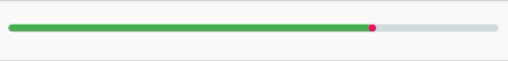
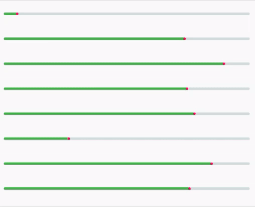
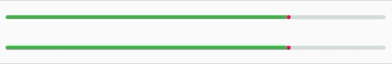
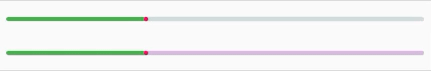
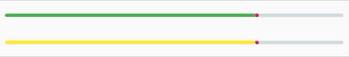
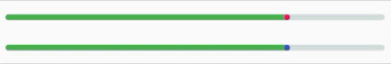
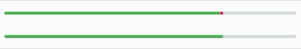
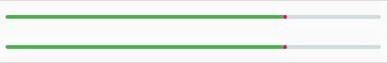
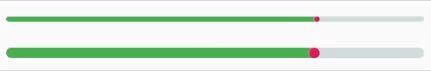

##   AnimatedProgressBar

Animated determinate horizontal progress bar for Android Views and Compose on Android, iOS, and desktop.

[](https://opensource.org/licenses/Apache-2.0)






## 💻 Installation

### Android XML Views

Add the View artifact to your app module. It supports API 14 and up and has no Compose dependencies.

```groovy
dependencies {
  implementation 'io.github.mckrpk:AnimatedProgressBar:1.2.0'
}
```

### Android-only Jetpack Compose

Add the Compose artifact to your Compose-enabled app module. Gradle selects the Android variant automatically. It supports API 21 and up.

```groovy
dependencies {
  implementation 'io.github.mckrpk:AnimatedProgressBar-compose:1.2.0'
}
```

### Compose Multiplatform

Add the same artifact to `commonMain` of your Compose Multiplatform module. It supports Android, iOS (`iosArm64`, `iosSimulatorArm64`, `iosX64`), and desktop JVM.

```kotlin
kotlin {
    sourceSets {
        commonMain.dependencies {
            implementation("io.github.mckrpk:AnimatedProgressBar-compose:1.2.0")
        }
    }
}
```

## ❔ Usage

### XML layout

Add the View to your layout. If the root already declares the `app` namespace, reuse it. The color resources below are examples from the Android sample. Supply your own resources or omit the color attributes to use the defaults.

``` xml
<com.mckrpk.animatedprogressbar.AnimatedProgressBar
    xmlns:android="http://schemas.android.com/apk/res/android"
    xmlns:app="http://schemas.android.com/apk/res-auto"
    android:id="@+id/animatedProgressBar"
    android:layout_width="match_parent"
    android:layout_height="wrap_content"
    android:layout_marginTop="8dp"
    app:animationDurationInMs="1600"
    app:animationStyle="snake"
    app:lineWidth="6dp"
    app:max="1000"
    app:progress="750"
    app:progressColor="@color/colorPrimary"
    app:progressTipColor="@color/colorAccent"
    app:progressTipEnabled="true"
    app:trackColor="@color/colorGray" />
```

### Programmatic Android View

``` kotlin
val progressBar = AnimatedProgressBar(this)
progressBar.setMax(100)
progressBar.setProgress(75)
progressBar.setTrackColor(Color.GRAY)
progressBar.setProgressColor(Color.GREEN)
progressBar.setProgressTipEnabled(true)
progressBar.setProgressTipColor(Color.RED)
progressBar.setAnimDuration(1200)
progressBar.setProgressStyle(AnimatedProgressBar.Style.SNAKE)
progressBar.setLineWidth(dpToPx(5, this).toInt())
```

### Compose

Use `AnimatedProgressBarStyle` in new code and in `commonMain`. Android callers passing the View's `AnimatedProgressBar.Style` can use the deprecated compatibility overload.

``` kotlin
import com.mckrpk.animatedprogressbar.compose.AnimatedProgressBar
import com.mckrpk.animatedprogressbar.compose.AnimatedProgressBarStyle

AnimatedProgressBar(
    progress = 75,
    max = 100,
    style = AnimatedProgressBarStyle.SNAKE,
    trackColor = Color.Gray,
    progressColor = Color.Green,
    progressTipEnabled = true,
    progressTipColor = Color.Red,
    lineWidth = 5.dp,
    animationDurationMillis = 1200,
    modifier = Modifier.padding(horizontal = 8.dp)
)
```

Every change of `progress`, `max`, `style` or `animationDurationMillis` replays the animation, like `setProgress()` does. The bar fills the available width and is `max(32dp, 3 * lineWidth)` high unless the `modifier` sets another size. Default colors, line width and duration are the same as in the View version (see `AnimatedProgressBarDefaults`). On Android the default progress and tip colors come from the theme's `colorPrimary` and `colorAccent`; on other platforms they are fixed.
## 🎨 Attributes

| name               | type               | default         | example |
|--------------------|--------------------|-----------------|---------|
| max                | Int                | 100             | 100     |
| progress           | Int                | 0               | 75      |
| style              | Enum: Line,  Snake | Line            |         |
| trackColor         | Int                | GREY            |         |
| progressColor      | Int                | Theme's primary |         |
| progressTipColor   | Int                | Theme's accent  |         |
| progressTipEnabled | Boolean            | true            |         |
| animDuration       | Int                | 1200ms          |         |
| lineWidth          | Int                | 4dp             |         |

## 📱 Samples

- `app`: Android sample with the View version and a screen comparing it with the Compose version. On a fresh checkout, set `android.useAndroidX=true` in the root `gradle.properties` or pass `-Pandroid.useAndroidX=true` to Gradle.
- `iosApp`: iOS sample using the Compose version (UI in the `sample-ios` module). Needs [XcodeGen](https://github.com/yonaskolb/XcodeGen):
  ```bash
  cd iosApp && xcodegen generate && open iosApp.xcodeproj
  ```
  Set your own `DEVELOPMENT_TEAM` in `iosApp/project.yml` to run it on a device. `SmokeUITests` taps the button and saves screenshots of the animation.

## 📃 License

    Copyright 2019 Michał Karpiuk

    Licensed under the Apache License, Version 2.0 (the "License");
    you may not use this file except in compliance with the License.
    You may obtain a copy of the License at

       http://www.apache.org/licenses/LICENSE-2.0

    Unless required by applicable law or agreed to in writing, software
    distributed under the License is distributed on an "AS IS" BASIS,
    WITHOUT WARRANTIES OR CONDITIONS OF ANY KIND, either express or implied.
    See the License for the specific language governing permissions and
    limitations under the License.

**Please don't hesitate to star the library if you find it useful or interesting.** 😊
